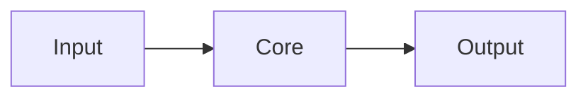

<!-- Copy to wiki/<Project>-—-Architecture.md -->
[← <Project>](<Project>) · [Home](Home)

# Architecture

> The system in one paragraph.

## Components

| Part | Lives in | Job |
|---|---|---|

## How a request flows

1. ...

## Constraints

Limits, assumptions, what breaks at scale.
