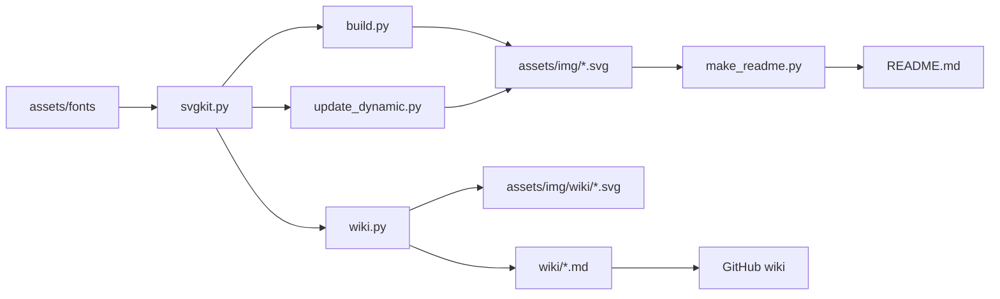

[← Profile README](Profile-README) · [Home](Home)

# Architecture

> The profile and this wiki are both static Markdown pointing at SVGs. Python draws the SVGs, GitHub Actions keeps them fresh, and nothing runs at view time.

## Components

| Part | Lives in | Job |
|---|---|---|
| Toolkit | `scripts/svgkit.py` | Colour tokens, text measuring and wrapping, cards, kickers and stamps. Subsets each font to the glyphs an image uses and embeds it as a woff2 `data:` URI, because GitHub's image proxy blocks external fonts. |
| Profile images | `scripts/build.py` | Every static README card, in dark and light. Holds the content too, so facts live in one place. |
| README | `scripts/make_readme.py` | Writes `README.md` as one-line `<picture>` tags, so dark mode survives GitHub's Markdown parser. |
| Daily refresh | `scripts/update_dynamic.py` | Pulls three headlines from EverythingTech and redraws the stats card from public GitHub data. |
| Wiki | `scripts/wiki.py` | Draws the wiki images and writes Home, the sidebar, the footer and the project pages from the docs it finds in `wiki/`. |

## How it stays fresh

1. **Every morning**, `refresh.yml` runs `update_dynamic.py` and commits the new headlines and stats card, then regenerates the contribution snake onto the `output` branch.
2. **On every push** that touches `wiki/` or the wiki script, `wiki.yml` rebuilds the wiki, commits the result and mirrors `wiki/` into this wiki's own git repo.

## Constraints

- **No JavaScript at view time.** GitHub strips scripts, so the motion (ticker, typing terminal, turning gear) is pure CSS inside each SVG.
- **Edit in the repo, never on the wiki.** The publish step mirrors `wiki/`, so a page edited in the browser is overwritten on the next push.
- **Page names are flat.** GitHub wikis ignore folders, so every doc's project goes in its name: `<Project>-—-<Doc>.md`.
